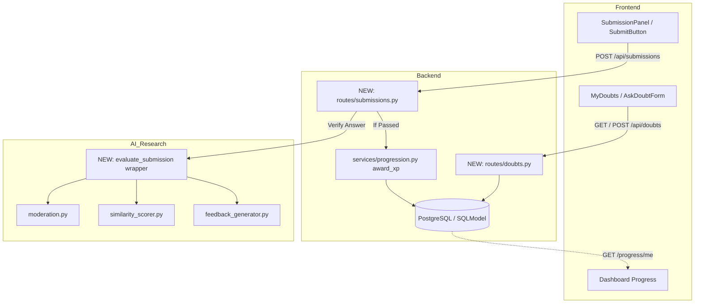

# SetuAI Cross-Team Integration Matrix

**Audit Date:** 2026-10-15  
**Audit Standard:** Cross-Boundary Contract Inspection & Data Flow Tracing  
**Location:** `docs/audit/INTEGRATION_MATRIX.md`

### Integration Status Classification:
- **Pass**: Both sides implemented, contracts match, and end-to-end data flow operates correctly.
- **Fail**: Interface mismatch, 404 missing endpoint, broken schema, or contract violation.
- **Blocked**: Cannot be integrated due to upstream dependency or missing architectural bridge.
- **Not Checked**: Incomplete implementation prevents live verification.

---

## 1. Cross-Team Integration Matrix

| Integration Boundary | Source Component | Target Component | Expected Contract / Schema | Actual Status | Classification | Evidence & Impact |
|---|---|---|---|---|---|---|
| **Frontend ↔ Backend** | `frontend/gamifiedsetu/api/submissionApi.ts` (`submitAnswer`) | `backend/routes/submissions.py` (`POST /api/submissions`) | Request: `{ challengeId: string, answer: string }` Response: `{ status: "pending"\|"passed"\|"needs_revision", feedback: string[], xpEarned: number }` | **Missing Route** No `routes/submissions.py` in backend. Calls return 404 if `USE_MOCK = false`. | **FAIL** | Frontend relies completely on fake mock timer (`mockSubmission.ts`). Real challenge verification and database persistence cannot occur. |
| **Frontend ↔ Backend** | `frontend/gamifiedsetu/api/doubtApi.ts` (`listDoubts`, `createDoubt`, `replyToDoubt`) | `backend/routes/doubts.py` (`GET/POST /api/doubts`, `POST /api/doubts/{id}/reply`) | Request: `{ question: string, learnerName: string }` Reply: `{ text: string, mentorName: string }` Response: `Doubt` object | **Missing Subsystem** No doubts model, routes, or database tables exist in backend. | **FAIL** | Frontend mentor mode persists strictly to local browser `localStorage` under `setuai_mock_doubts`. No peer-to-peer or learner-to-mentor persistence across devices. |
| **Frontend ↔ Backend** | `frontend/gamifiedsetu/hooks/useSubmission.ts` | `backend/services/progression.py` (`award_xp`) | Request: `challenge_id`, authenticated user token Response: `{ total_xp, level, xp_awarded, leveled_up, xp_to_next_level, badges_unlocked }` | **Disconnected Engine** `award_xp` service exists in backend, but has no API route exposed (`POST /challenges/{id}/complete` is missing). | **FAIL** | Frontend maintains a disconnected local `totalXp` state in React memory that resets on page reload. Real XP is never saved to the database. |
| **Frontend ↔ Backend** | `frontend/gamifiedsetu` (Clerk Auth Token) | `backend/middleware/auth.py` (`get_current_user_id`, `get_current_user`) | Header: `Authorization: Bearer <session_token>` Backend checks `CLERK_SECRET_KEY` and syncs `User` row. | **Architectural Pass** Both sides use Clerk SDKs and share common user ID convention. Live handshake unverified. | **NOT CHECKED** | Both sides agree on protocol, but no live API requests currently flow from frontend to backend with Clerk Bearer headers. |
| **Frontend ↔ Backend** | `frontend/gamifiedsetu/app/dashboard/page.tsx` | `backend/routes/progress.py` (`GET /progress/{user_id}`) | Response: `ProgressRead` (`{ user_id, module_id, completed, completed_at }`) | **Unused Backend Endpoint** Backend exposes `/progress/{user_id}`, but frontend dashboard hardcodes "0 XP · Level 1" placeholder. | **FAIL** | Learner dashboard does not fetch user progress or curriculum status from backend API. |
| **AI Research ↔ Backend** | `Ai Research/image_generator.py`, `similarity_scorer.py`, `feedback_generator.py` | `backend/services/ai_evaluation.py` | Python function call: `evaluate_submission(prompt: str, reference_image) -> dict` | **Complete Isolation** Zero shared imports or network calls between `backend/` and `Ai Research/`. | **BLOCKED** | Backend cannot grade AI Prompt Lab challenges using AI Research models. AI Research remains an isolated research workspace. |
| **AI Research ↔ Backend** | `Ai Research/moderation.py` (`moderate_prompt`, `moderate_output_text`) | `backend/middleware/moderation.py` or `routes/submissions.py` | Pre-flight prompt validation before processing. Raises `ContentModerationError`. | **Unused Safety Engine** Wave 2 moderation engine is fully verified in AI Research, but not imported into Backend routes. | **BLOCKED** | Backend input endpoints have no automated moderation or PII filtering applied. |
| **UI/UX ↔ Frontend** | `UI-UX Files/` Design System (`index.html`, colors, fonts) | `frontend/gamifiedsetu/app/globals.css` | Color hex codes, typography rules, component borders, and hard shadow utilities. | **High Fidelity Parity** Tailwind v4 tokens accurately reproduce cream/ink/coral theme and Player Sans Mono. | **PASS** | Visual style of Landing, Onboarding, and Mascot components matches UI/UX specifications. |
| **UI/UX ↔ Frontend** | `UI-UX Files/SetuAI mascots/mascots svg/` | `frontend/gamifiedsetu/public/mascots/` | SVG files for Bug, Byte, Nova, Spark across idle and dismissed states. | **Asset Parity** All 9 required mascot SVGs were copied to `public/mascots/` and render in components. | **PASS** | Mascots render high-resolution vector graphics with pose transitions. |
| **UI/UX ↔ Frontend** | `UI-UX Files/Onboarding Beginner Guide/setuai-onboarding.html` | `frontend/gamifiedsetu/app/onboarding/page.tsx` | 4-step onboarding guide introducing Spark, XP, and levels. | **Direct Implementation** Frontend ported the 4 steps, mascot SVGs, and navigation into React. | **PASS** | Functional onboarding flow works smoothly. |
| **UI/UX ↔ Frontend** | Brand styling guidelines | `frontend/gamifiedsetu/app/components/mentor-mode/AskDoubtForm.tsx` | Brand tokens: `border-ink`, `border-4`, `shadow-[8px_8px_0_#172A32]`, `bg-cream`. | **Style Inconsistency** `AskDoubtForm.tsx` used `border-gray-200` and thin borders. | **FAIL** | Breaks visual continuity with the rest of the application. |
| **Backend ↔ Database** | `backend/models/*.py` | PostgreSQL Database Schema | Tables: `users`, `modules`, `sub_modules`, `challenges`, `completed_challenges`, `badges`, etc. | **Evolution Failure** `SQLModel.metadata.create_all` does not apply column additions (`total_xp`, `level`) to existing DBs. | **FAIL** | Connecting to an existing production/staging database causes SQL query crashes unless raw `ALTER TABLE` is executed manually. |

---

## 2. In-Depth Analysis of Critical Integration Failures

### A. The "Mock Illusion" in Frontend
Both major frontend feature sets built in Wave 3:
1. **Submission & Feedback UI (Step 6)**
2. **Mentor Mode Doubts (Step 7)**
rely on hardcoded mock switches:
- `api/submissionApi.ts`: `export const USE_MOCK = true;`
- `api/doubtApi.ts`: `export const USE_MOCK = true;`

While mock mode enabled frontend developers to build and test UI components in isolation, **the corresponding backend routes (`/api/submissions` and `/api/doubts`) were never merged to `main`**. Switching `USE_MOCK = false` today causes total application failure with unhandled HTTP 404 errors.

### B. Progression Engine Disconnection
In backend commit `f1b895e` (Step 5.3), Pair B1 successfully implemented:
- Pure level calculation math (`config/progression_rules.py`)
- Database models for challenges, badges, and certificates (`models/`)
- Atomic XP awarding service with concurrency collision protection (`services/progression.py`)

However, **Step 5.4 (`POST /challenges/{id}/complete`) was never implemented**. There is no route handler exposing this service to HTTP clients. Consequently:
- Frontend challenge completion cannot trigger backend XP awards.
- User levels, total XP, and badges remain static in the database.
- The progression engine is an isolated service without an ingress.

### C. AI Research Air-Gap
The AI Research team has achieved substantial progress on:
- CLIP image similarity scoring
- Stability AI image generation
- Anthropic Claude feedback classification
- Wave 2 Content Moderation with Contextual Entity Masking

However, this work exists as a disconnected set of research scripts in `Ai Research/`. No architectural contract has been implemented to allow FastAPI backend workers to invoke these AI capabilities.

---

## 3. Integration Action Plan

