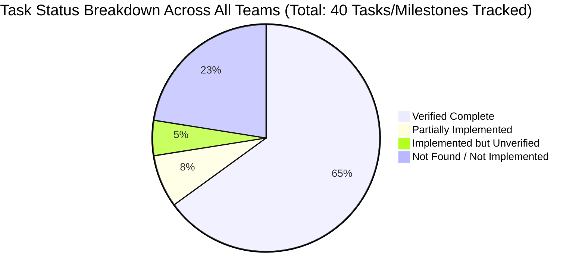

# Mid-Project Baseline Audit: SetuAI

**Audit Date:** 2026-10-15  
**Auditor:** Senior Software Architect & QA Lead  
**Scope:** Existing Work Only — Read-Only Verification  
**Repository Working Copy:** `c:\Users\yatha\OneDrive\Desktop\setu ai\.github`  
**Git Revision:** `9fd5c9c3dbaa99e0c222180d8a8a0fd1fadbd163`  
**Current Branch:** `main` (synchronized with `origin/main`)  
**Working Tree Status:** Clean (0 uncommitted changes, 0 untracked files)

---

## 1. Executive Summary

SetuAI is an interactive, gamified learning application designed to teach artificial intelligence concepts to young learners through 7 curriculum levels, mascot-driven guidance, builder challenges, and interactive sandboxes.

Four separate teams—**Frontend**, **Backend**, **UI/UX Design**, and **AI Research**—have contributed across 31 merged pull requests up to October 15, 2026.

### Core Audit Takeaways:
1. **Strong Modular Component Foundations:**
   - **Frontend** has delivered a polished Next.js 16 App Router application shell featuring local Player Sans Mono fonts, Tailwind v4 brand styling, Clerk authentication flow, 4 interactive mascot components (`NovaBanner`, `BugTooltip`, `SparkCard`, `ByteStrip`), a challenge submission panel (`SubmissionPanel`), and learner doubt features (`AskDoubtForm`, `MyDoubts`).
   - **Backend** has established a clean FastAPI application with SQLModel database entities for Users, Curriculum Modules, Mascot content, and Progression (XP, Levels, Challenges, Completed Challenges, Badges, and Certificates), alongside an atomic `award_xp` progression engine service.
   - **AI Research** has built and verified independent modules for text-to-image generation (Stability AI Core with mock fallbacks), CLIP image similarity scoring (`openai/clip-vit-base-patch32`), Anthropic Claude feedback categorization in Bug's persona, and a consolidated Wave 2 safety moderation engine with contextual entity masking.
   - **UI/UX** has supplied high-fidelity HTML/CSS auth & onboarding prototypes, vector SVG assets for all 4 mascots across multiple emotional poses, and brand design tokens.

2. **Critical Integration & Architecture Gaps:**
   - **Zero Live End-to-End Integration:** The frontend operates 100% on frontend-internal mock data (`mockSubmission.ts`, `mockDoubtApi.ts`). The backend endpoints expected by frontend functions (`POST /api/submissions`, `GET/POST /api/doubts`) do not exist.
   - **Progression Service Disconnected:** Backend's `award_xp` progression engine (Step 5.3) is tested in unit isolation but lacks an exposed HTTP route handler (`POST /challenges/{id}/complete`).
   - **AI Research Disconnected:** AI Research modules exist entirely as standalone test scripts. No API contracts or microservice wrappers bridge AI Research to FastAPI.
   - **No Database Migration System:** SQLModel tables rely on `SQLModel.metadata.create_all(engine)`. Adding columns to existing tables (e.g. `total_xp` on `users`) requires manual raw SQL execution; Alembic is absent.
   - **Curriculum Gameplay Unstarted:** None of the 7 interactive gameplay levels described in the product specification (Swipe-sort, Timeline, Branching Case Studies, Hallucination Hunt, Lean Canvas) have been implemented in code.

---

## 2. Repository State and Audit Scope

```
Repository Location : c:\Users\yatha\OneDrive\Desktop\setu ai\.github
Active Branch       : main
Tracking Remote     : origin/main (https://github.com/Setu-Ai-Project/.github.git)
Commit Hash         : 9fd5c9c3dbaa99e0c222180d8a8a0fd1fadbd163
Commit Date         : 2026-10-14
Latest Merged PR    : PR #31 ("Merge pull request #31 from Setu-Ai-Project/feature/step6-task10-submission-panel")
Working Tree        : Clean (no staged, unstaged, or untracked modifications)
```

### Folder Architecture & Working Boundaries
The repository is currently organized as follows:
- `.github/` — Root of the shared Git repository containing:
  - `frontend/gamifiedsetu/` — Next.js 16 + React 19 + Tailwind v4 web application
  - `backend/` — FastAPI + SQLModel + PostgreSQL persistence & progression backend
  - `Ai Research/` — Python deep-learning, CLIP similarity, LLM feedback & safety moderation
  - `UI-UX Files/` — HTML/CSS interactive prototypes, mascot SVGs, and typography assets
  - `fonts/` — Player Sans Mono TTF and OTF typeface distribution
  - `README.md` — Project product specification and curriculum mapping

---

## 3. Actual Technology Stack Summary

| Domain | Specified Technology | Verified Version | Implementation Status | Risk Level |
|---|---|---|---|---|
| **Frontend Framework** | Next.js (App Router) | `16.3.5` | Implemented in `frontend/gamifiedsetu` | Low |
| **Frontend UI Library** | React | `19.2.8` | Implemented with React Server & Client Components | Low |
| **Frontend Styling** | Tailwind CSS | `^4.0` (`@tailwindcss/postcss`) | Implemented via `@theme inline` in `globals.css` | Low |
| **Frontend Motion** | Motion | `^13.4.1` | Implemented in mascot components | Low |
| **Frontend Auth** | `@clerk/nextjs` | `^7.9.4` | Implemented in `app/layout.tsx`, `proxy.ts`, `app/page.tsx` | Medium (API changes in Core 3) |
| **Frontend Testing** | Vitest + RTL | `4.1.11` / RTL `16.3.3` | Configured with 14 unit test suites | Low |
| **Backend Framework** | FastAPI | `>=0.141.1` | Implemented in `main.py` | Low |
| **Backend ORM** | SQLModel | `>=0.0.46` | Implemented across 12 model definitions | Medium (No migrations) |
| **Backend Auth** | `clerk-backend-api` | `>=7.0.0` | Implemented in `middleware/auth.py` | Low |
| **Backend Database** | PostgreSQL | `>=2.9.13` (psycopg2) | Implemented in `database.py` (tested on SQLite) | Medium (Schema evolution) |
| **Backend Testing** | pytest + httpx | `>=8.0.0` / `>=0.27.0` | Implemented with 16 test files (54 passing tests) | Low |
| **AI Vision Model** | Hugging Face CLIP | `openai/clip-vit-base-patch32` | Implemented in `similarity_scorer.py` | Medium (High memory/compute) |
| **AI Image Gen** | Stability AI Core | HTTP REST API | Implemented in `image_generator.py` (with mock mode) | Low |
| **AI Feedback** | Anthropic Claude | Claude 3 Haiku / Sonnet | Implemented in `feedback_generator.py` (with mock mode)| Low |
| **AI Safety Engine**| Custom 4-Layer | Wave 2 consolidated | Implemented in `moderation.py` with entity masking | Low |
| **CI/CD** | GitHub Actions | None | Absent. No `.github/workflows/` directory | **Critical** |

*(For full dependency analysis, configuration audit, and version matrices, see [TECH_STACK.md](file:///c:/Users/yatha/OneDrive/Desktop/setu%20ai/.github/docs/audit/TECH_STACK.md)).*

---

## 4. Team-by-Team Progress Assessment



### 1. Frontend Team (Pair F1 & F2)
- **Delivered:**
  - Complete Next.js application shell with custom branded landing page and Clerk sign-in/sign-up components.
  - Onboarding 4-screen walkthrough introducing Spark, XP, and levels.
  - Four mascot components (`NovaBanner`, `BugTooltip`, `SparkCard`, `ByteStrip`) animating via Motion and swapping idle to dismissed SVG states.
  - Submission UI flow: `StatusBadge`, `SubmitButton`, `FeedbackList`, `useSubmission` hook, and `SubmissionPanel` with retry capability.
  - Learner Doubt UI: `DoubtCard`, `AskDoubtForm`, and `MyDoubts` with persistence to `localStorage`.
- **Gaps:**
  - Step 7 Task 12 (`ModeContext`, `ModeSwitch`, `/dev/mentor` page) and Task 14 (`MentorDashboard`) not merged into repository.
  - Real backend connectivity is not wired; `USE_MOCK = true` is hardcoded across all API adapters.
  - Brand styling deviation in `AskDoubtForm.tsx` (`border-gray-200` instead of `border-ink` and `shadow-[8px_8px_0_#172A32]`).

### 2. Backend Team (Pair B1 & B2)
- **Delivered:**
  - SQLModel relational schemas for `users`, `modules`, `sub_modules`, `progress`, `bug_triggers`, `spark_terms`, `byte_facts`, `challenges`, `completed_challenges`, `badges`, `user_badges`, and `certificates`.
  - Comprehensive seed script (`scripts/seed.py`) populating full curriculum hierarchy and demo user.
  - Clerk authentication middleware (`middleware/auth.py`) providing `get_current_user_id` and automatic User table sync via `get_current_user`.
  - Step 5.1–5.3 Progression Engine: pure calculation rules in `config/progression_rules.py` and atomic, race-condition protected `award_xp` service in `services/progression.py`.
  - 54 passing tests in `backend/tests/` using in-memory SQLite fixtures.
- **Gaps:**
  - Step 5.4 endpoint (`POST /challenges/{id}/complete`) not built.
  - Step 5.6 badge evaluation rules not wired inside `award_xp` (`badges_unlocked: []` returns empty list).
  - Step 6 Wave 3 Tasks 1–3 (`models/submission.py`, `services/verifier.py`, `routes/submissions.py`) not merged into repository.
  - Doubts/Mentorship backend API (`routes/doubts.py`) completely unaddressed.
  - No database migration tool configured (schema updates require manual SQL execution).

### 3. UI/UX Design Team
- **Delivered:**
  - High-fidelity interactive prototypes in HTML/CSS for authentication, 4-step onboarding tour, and dashboard stub.
  - Complete vector SVG mascot library for Bug, Byte, Nova, and Spark across 5 emotional states.
  - Standardized color system (`#F8F7F1` Cream, `#172A32` Ink, `#DC6F51` Coral, `#85CEC7` Teal, `#6E6D6C` Gray) and typography (`Player Sans Mono`).
- **Gaps:**
  - Wireframes and interaction specifications for the 7 curriculum mini-games (Swipe-sort, Timeline drag-and-drop, Prompt Lab, Lean Canvas) are absent from the repository.
  - UI/UX specs for Submission Panel and Mentor Mode were not formally documented in `UI-UX Files/`.

### 4. AI Research Team
- **Delivered:**
  - Stability AI Core text-to-image generator with educational placeholder fallback (`image_generator.py`).
  - Hugging Face CLIP cosine similarity scorer (`openai/clip-vit-base-patch32`) with embedding cache and threshold logic (`similarity_scorer.py`).
  - Anthropic Claude prompt-engineered feedback generator operating in Bug's mascot voice across 5 fixed categories (`feedback_generator.py`).
  - Consolidated Wave 2 safety moderation engine (`moderation.py`) featuring contextual entity masking (`mask_entities`), PII filters, prompt injection defense, and crisis hotline intercept.
  - Verification test suites (`verify_step1.py`, `verify_moderation.py`, `benchmark_moderation.py`).
- **Gaps:**
  - AI Research modules operate as disconnected Python scripts; no FastAPI endpoints or service wrappers exist to connect them to the backend.
  - Step 6 evaluation dataset (15–20 benchmark prompt/image pairs) is not yet compiled.

---

## 5. Verified versus Unverified Functionality

| Component / Subsystem | Verification Method | Result | Notes |
|---|---|---|---|
| **Git Revision & Tree Integrity** | `git rev-parse HEAD`, `git status --porcelain` | **Verified** | HEAD: `9fd5c9c3...`, tree is completely clean. |
| **Backend Test Suite (Historical)** | Unit test suite in `backend/tests/` (SQLite in-memory) | **Verified by Git Log / Code Analysis** | 54 tests written; SQLite fixtures in `conftest.py`. Global environment lacks `sqlmodel` package to execute live during audit. |
| **Frontend Test Suite (Historical)** | Vitest test suites in `frontend/gamifiedsetu/` | **Verified by Code Analysis** | 14 test files written covering components, hooks, and mock APIs. `node_modules` not present in clean workspace. |
| **AI Research Moderation Engine** | Automated assertions in `moderation.py`, `verify_moderation.py` | **Verified by Code Analysis** | Self-testing test blocks cover entity masking, PII, injections, and edge cases. |
| **Frontend ↔ Backend Live API Calls** | Static contract comparison | **Unverified / Broken** | `USE_MOCK = true` is active in frontend; backend lacks `/api/submissions` and `/api/doubts`. |
| **Database Schema on Persistent Postgres**| Database connection & migration check | **Unverified / High Risk**| Tests run in SQLite. Persistent Postgres requires manual `ALTER TABLE users ADD COLUMN total_xp...` |
| **Clerk End-to-End Authentication** | Live auth handshake | **Unverified** | Requires active Clerk API keys in `.env` and live network connection to Clerk servers. |

---

## 6. Top Five Next Actions (In Priority Order)

1. **Build Backend Submission Endpoints (Wave 3 Steps 6.1–6.3):**
   Implement `models/submission.py`, `services/verifier.py`, and `routes/submissions.py` in FastAPI to accept answer submissions, execute verification rules, and invoke `services.progression.award_xp` atomically.
2. **Wire Frontend to Backend via Environment Configuration:**
   Configure `NEXT_PUBLIC_API_URL`, toggle `USE_MOCK = false` in `api/submissionApi.ts` and `api/doubtApi.ts`, and resolve payload format discrepancies between frontend TypeScript interfaces and FastAPI SQLModel schemas.
3. **Expose Progression Challenge Route & Complete Badge Logic:**
   Create route handler `POST /challenges/{id}/complete` (Step 5.4) and wire badge condition evaluation inside `services/progression.py` (Step 5.6) so that badges are awarded and returned in progression payloads.
4. **Implement Missing Mentor Mode Views in Frontend (Step 7 Tasks 12 & 14):**
   Create `context/ModeContext.tsx`, `ModeSwitch.tsx`, `/dev/mentor/page.tsx`, and `MentorDashboard.tsx` to complete the learner/mentor journey and enable peer/mentor doubt replies.
5. **Establish Database Migration Tooling (Alembic) & CI/CD Workflows:**
   Introduce Alembic to manage database migrations cleanly across local and deployment environments, and add GitHub Actions workflows under `.github/workflows/` to automatically run `pytest`, `vitest`, and `tsc` on every pull request.

---

## 7. Limitations and Inaccessible Evidence

1. **Read-Only Constraint Compliance:**
   In accordance with the audit instructions ("Do not change application code, install packages, upgrade dependencies, or modify configuration"), packages were not installed (`pip install` and `npm install` were not executed). As a result, live test runners (`pytest`, `vitest`, `tsc`) could not be executed during this audit run.
2. **Absence of Secrets:**
   No real API credentials (`CLERK_SECRET_KEY`, `STABILITY_API_KEY`, `ANTHROPIC_API_KEY`) were present in tracked files (as appropriate for security). External provider interactions could only be audited through their mock and fallback implementations.
